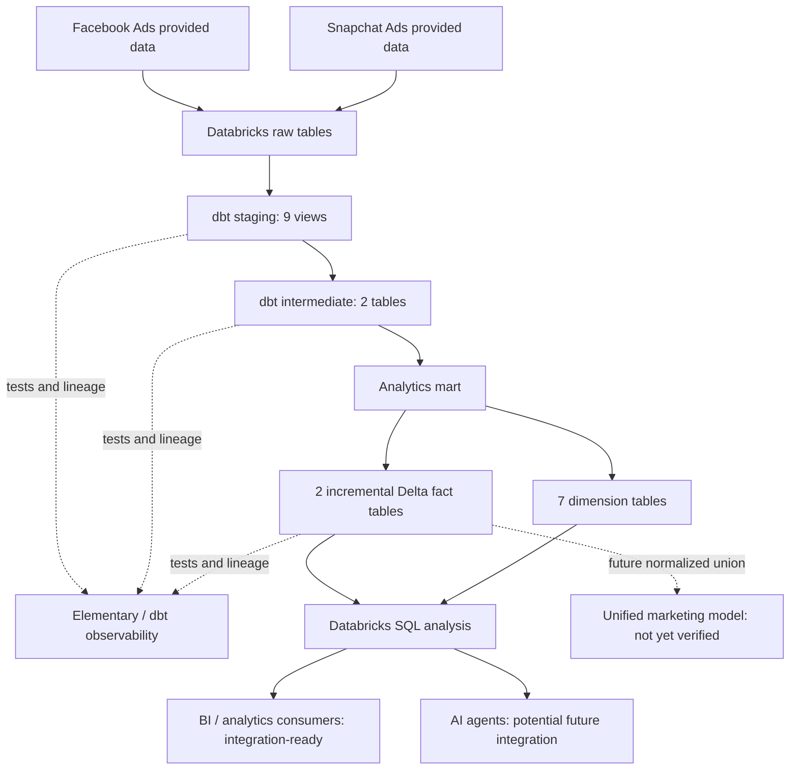

# Legacy Marketing Data Platform

**CoreDataEngineers | Databricks + dbt take-home case study**

[GitHub repository](https://github.com/shirmino/legacy_marketing)

## 1. Business context and objective

The marketing team uses **Facebook Ads** and **Snapchat Ads** to track campaign spending, impressions and clicks. Separate platform interfaces and spreadsheet exports make comparisons time-consuming, restrict access to marketing data, and reduce reuse and governance.

This project builds the first version of a governed, reusable marketing analytics platform: provided raw advertising datasets are stored in Databricks, transformed with dbt, validated with automated tests, and published as analytical tables for SQL-based analysis. The design aims to support analysts and, with further semantic and consumption-layer work, BI dashboards and AI-assisted analytics.

The assignment's target is a **unified cross-platform marketing model**. The verified implementation currently publishes **two platform-specific performance fact tables** and their dimensions; a separate, persisted `fct_marketing_spend` or equivalent unified model has **not been verified**. A common-query example is included below, and creating a documented unified model remains an explicit next step.

### Business questions

- What is total spend, and how does it compare across Facebook and Snapchat?
- How many impressions and clicks were generated by each platform, campaign and date?
- Which campaigns lead on spend, clicks or impressions?
- How does performance change over time?
- What are **CTR**, **CPC** and **CPM**?

Definitions, with divide-by-zero protection:

| Metric | Definition |
| --- | --- |
| Spend | Sum of advertising spend in the underlying source currency; cross-currency sums require normalization |
| Impressions | Sum of recorded impressions |
| Clicks | Sum of recorded clicks |
| Click-through rate (CTR) | `clicks / NULLIF(impressions, 0)` |
| Cost per click (CPC) | `spend / NULLIF(clicks, 0)` |
| Cost per 1,000 impressions (CPM) | `1000 * spend / NULLIF(impressions, 0)` |

CTR is expressed as a ratio; multiply by 100 for a percentage. When the denominator is zero, the ratio is `NULL` rather than a misleading zero. Campaign-level attribution and cross-platform comparisons require compatible identifiers, date conventions and currency handling.

## 2. Technology stack

| Component | Technology | Role |
| --- | --- | --- |
| Storage and SQL | Databricks, Delta Lake | Raw datasets, transformation execution, Delta MERGE |
| Governance | Unity Catalog | Catalogs, schemas, privileges |
| Transformation | dbt Core 1.12.5, dbt-databricks 1.12.6 | Models, lineage, tests, incremental builds |
| Observability | **Elementary dbt package** | Observability resources and dbt test-result metadata |
| Runtime | Python 3.11, `uv` | Reproducible Python environment |
| Development | Git, GitHub, VS Code, Ubuntu WSL | Version control and local development |
| Automation | GitHub Actions | PR validation and approved production deployment |

## 3. End-to-end architecture



**Separation of concerns:** source/raw data → reusable transformations → analytical models → consumption. The project uses pre-existing provided files loaded into Databricks; no live advertising API ingestion is implemented.

## 4. Data sources

Nine raw source tables are declared through platform-specific `sources.yml` files.

**Facebook (5)**

- `facebook_ads_stats`
- `facebook_new_acccount_de_randomized`
- `facebook_new_adgroup_de_randomized`
- `facebook_new_ads_de_randomized`
- `facebook_new_campaign_de_randomized`

**Snapchat (4)**

- `snapchat_ads_stats`
- `snapchat_ads_ad_history_new_ad_names`
- `snapchat_ads_adgroup_history_new_ad_group_names`
- `snapchat_ads_campaign_history_new_campaign_names`

Source definitions: `legacy_marketing/models/staging/facebook/sources.yml` and `legacy_marketing/models/staging/snapchat/sources.yml`.

Source naming, data types, identifiers and grain differ by platform. Staging standardizes those differences before downstream modeling.

## 5. dbt model design and materializations

| Layer | Facebook | Snapchat | Total | Materialization |
| --- | ---: | ---: | ---: | --- |
| Staging | 5 | 4 | **9** | View |
| Intermediate | 1 | 1 | **2** | Table |
| Dimensions | 4 | 3 | **7** | Table |
| Performance facts | 1 | 1 | **2** | Incremental Delta MERGE |
| **Custom models** | **11** | **9** | **20** | |

These counts exclude models installed by dbt packages such as Elementary.

### Staging — source cleaning and normalization

**Facebook:** `stg_facebook_accounts`, `stg_facebook_adgroups`, `stg_facebook_ads`, `stg_facebook_ads_stats`, `stg_facebook_campaigns`.

**Snapchat:** `stg_snapchat_adgroups`, `stg_snapchat_ads`, `stg_snapchat_ads_stats`, `stg_snapchat_campaigns`.

Staging views provide source-aligned cleaning, renaming and type conversion without persisting another full copy of the data. This reduces storage and keeps early transformations close to source changes.

### Intermediate — reusable performance transformations

- `int_facebook_ads_performance`
- `int_snapchat_ads_performance`

Intermediate models are persisted as tables to reuse prepared performance data in downstream transformations without recomputing the full intermediate logic on every query. This is a deliberate compute-versus-storage trade-off.

### Mart — dimensions and facts

**Facebook dimensions:** `dim_facebook_accounts`, `dim_facebook_adgroups`, `dim_facebook_ads`, `dim_facebook_campaigns`.

**Snapchat dimensions:** `dim_snapchat_adgroups`, `dim_snapchat_ads`, `dim_snapchat_campaigns`.

**Facts:** `fct_facebook_ads_performance`, `fct_snapchat_ads_performance`.

Dimensions describe accounts, campaigns, ad groups and advertisements as available by platform. Facts carry performance measures such as spend, impressions and clicks. The model design uses platform-specific dimensions because the source entities and identifiers are not automatically interchangeable.

### Grain and keys

- **Facebook fact:** one record per `ad_id` and `ad_date` according to its configured merge key.
- **Snapchat fact:** one record per `ad_id`, `ad_date`, `country`, `currency_code`, and `data_src` according to its configured merge key.
- **Dimension grain:** one entity per relevant platform-specific business identifier, subject to the SQL model's deduplication rules. Consult individual model SQL/YAML for the exact key and historical-record selection logic.

A configured dbt merge key is an intended grain, not a database-enforced primary key. Source deduplication and uniqueness tests are important to prevent duplicate-key MERGE failures or incorrect metrics.

### Why these materializations?

- **Views for staging:** low storage duplication and easy inspection of normalized source fields.
- **Tables for intermediate and dimensions:** reusable, queryable persisted transformations.
- **Incremental for facts:** upsert existing records and insert new records using Delta MERGE.
- **Ephemeral:** considered as an available dbt option, but not used in the verified custom-model inventory; it would be less convenient for direct inspection and reuse of these intermediates.

Materialization decisions balance data volume, reuse, query cost, maintenance and the ability to correct historical records.

## 6. Incremental Delta MERGE strategy

The fact models use `materialized='incremental'`, `incremental_strategy='merge'`, and `on_schema_change='fail'`.

| Fact | `unique_key` |
| --- | --- |
| Facebook | `['ad_id', 'ad_date']` |
| Snapchat | `['ad_id', 'ad_date', 'country', 'currency_code', 'data_src']` |

The source data has no confirmed reliable watermark or CDC indicator that captures every historical correction. For that reason, these models **do not apply a date-based `is_incremental()` source filter**: each run can compare the full transformed source against the target and update existing keys. This favors correctness and repeatability over the scan savings of a true CDC-based incremental feed.

`on_schema_change='fail'` prevents unreviewed schema drift. Isolated Databricks SQL MERGE experiments demonstrated updates to existing rows without inserting new rows. A full dbt-level historical-correction regression test is a **future improvement**, not a completed verification.

## 7. Data quality and validation

YAML and SQL tests cover model/source integrity, including uniqueness, non-null identifiers, relationships and duplicate checks. Additional source profiling and reconciliation checks were performed during development.

Examples of desirable analytical constraints include nonnegative spend, impressions and clicks; accepted platform values; and valid foreign-key relationships. The exact implemented assertions should be verified in the model YAML files before claiming each example is automated.

### Known source-data warning

The latest successful CI and production builds reported **191 passes, 1 warning, 0 errors**. The warning is a Snapchat ad-to-ad-group relationship test, with **304 unmatched ad-group references**. This warning is documented rather than hidden; it should be investigated with the data provider or explicitly handled under an agreed business rule.

### Production reconciliation

The following production values were queried in Databricks and matched previously validated development aggregates:

| Metric | Facebook | Snapchat |
| --- | ---: | ---: |
| Fact rows | 92,300 | 2,809 |
| Spend | 9,432,098.2300 | 30,529.5459 |
| Impressions | 905,449,421 | 33,395,784 |
| Clicks | 5,737,710 | 19,012 |

**Combined fact rows: 95,109.** Matching aggregates are a useful reconciliation check but do not prove row-by-row equivalence or semantic comparability of spend currencies.

Reproduce the totals:

```sql
SELECT 'Facebook' AS platform, COUNT(*) AS total_rows,
       ROUND(SUM(spend), 4) AS total_spend,
       SUM(impressions) AS total_impressions,
       SUM(clicks) AS total_clicks
FROM bronze_production.legacy_mart.fct_facebook_ads_performance
UNION ALL
SELECT 'Snapchat', COUNT(*), ROUND(SUM(spend), 4),
       SUM(impressions), SUM(clicks)
FROM bronze_production.legacy_mart.fct_snapchat_ads_performance;
```

## 8. Elementary observability — implemented

**Elementary is installed and integrated as a dbt package in this project.** Its package resources are part of the dbt project and were included in successful automated builds. This is distinct from simply planning to adopt Elementary.

Elementary supports observability workflows around:

- dbt test results and failed/warned tests;
- model and data quality health;
- historical test-result visibility when artifacts and metadata are collected over time;
- anomaly monitoring where monitors are configured;
- report generation and operational review where the Elementary CLI/reporting workflow is configured.

**Verified scope:** package integration and execution of Elementary dbt resources as part of the build. A generated Elementary HTML report, scheduled anomaly monitors, historical dashboards and automated alert delivery have **not been independently verified** in the information documented here. Do not interpret package installation alone as proof those operational capabilities are enabled.

For further inspection, review `legacy_marketing/packages.yml`, the Elementary model configuration in `dbt_project.yml`, and Elementary resources in the dbt manifest. The known Snapchat relationship warning is a concrete example of a data-quality issue that an observability workflow should surface.

## 9. dbt documentation and lineage

Each custom SQL model has a corresponding YAML file, and the source declarations are organized by platform. These files provide the structure for model, column, source and test documentation.

Generate static dbt documentation and lineage locally:

```bash
cd legacy_marketing
uv run dbt deps --target dev
uv run dbt docs generate --target dev
uv run dbt docs serve --target dev
```

`dbt docs generate` produces the catalog and manifest artifacts used by the static documentation site. The lineage graph allows reviewers to trace raw sources through staging and intermediate models into dimensions and facts. **The repository's committed static HTML output has not been verified**; generating and publishing a documentation artifact remains a final-deliverable check.

Documentation should specify business meaning, source lineage, grain, unique keys, measures and data-quality assumptions. In particular, spend currency and platform-specific dimension semantics need to be explicit for unified reporting.

## 10. Environment isolation

| dbt target | Catalog | Schema(s) | Purpose |
| --- | --- | --- | --- |
| `dev` | `bronze_staging` | `legacy_dev` | Local development and iteration |
| `ci` | `bronze_staging` | `legacy_ci` | Pull-request builds and tests |
| `production` | `bronze_production` | `legacy_staging` for staging/intermediate; `legacy_mart` for marts | Production analytical data |

The custom `generate_schema_name.sql` macro handles environment-specific routing. CI and development do not write into the production mart. Fact-level incremental configs override default mart materialization settings.

## 11. CI/CD with GitHub Actions

### CI — pull requests to `main`

Workflow: `.github/workflows/dbt_ci.yml`.

1. Checkout repository.
2. Install `uv` and locked Python dependencies.
3. Execute `dbt deps --target ci`.
4. Execute `dbt debug --target ci`.
5. Execute `dbt build --target ci` (models and tests).
6. Review results before merging.

CI runs in `bronze_staging.legacy_ci`, keeping validation separate from production.

### CD — merges/pushes to `main`

Workflow: `.github/workflows/dbt_cd.yml`.

1. A push to `main` starts the production workflow.
2. GitHub's `production` environment requires reviewer approval; deployment is restricted to `main`.
3. The workflow installs dependencies and runs `dbt deps`, `dbt debug`, and `dbt build` with `--target production`.
4. A concurrency group prevents overlapping production deployments.
5. Successful production builds are validated by querying mart tables.

**Observed result:** the production deployment succeeded with **191 passed, 1 warning, 0 errors, 0 skipped**. The warning is the known Snapchat relationship issue. The build validates the current deployment; it is not a substitute for a rollback strategy or scheduled production refresh policy.

## 12. Security, authentication and Unity Catalog

- **Local development:** Databricks Personal Access Token (PAT) in a Git-ignored local profile or environment variable.
- **CI and production:** Databricks **service principal OAuth** credentials, not a personal production PAT.
- **GitHub secrets:** `DBX_ID_APPLICATION_ID` and `DBX_SECRET`.
- **Profiles:** `legacy_marketing/profiles.yml` for local use; `.github/profiles.yml` for Actions (reads environment variables).
- **Unity Catalog:** service-principal privileges scoped to the catalogs and schemas needed for CI and production, including catalog/schema use and table creation/modification. Personal read access to `bronze_production.legacy_mart` is granted separately.

Use the least-privilege principle. The assignment's example grants (including metastore-level permissions) are **illustrative**, not a requirement to grant broad metastore access in this implementation. Do not commit credentials or real `.env` files. Revoke and rotate any credential accidentally exposed in Git history or logs.

## 13. Repository layout

```text
legacy_marketing/                     # Git repository root
├── .github/
│   ├── workflows/
│   │   ├── dbt_ci.yml
│   │   └── dbt_cd.yml
│   └── profiles.yml                  # CI/CD env-var based profile
├── legacy_marketing/                 # dbt project directory
│   ├── macros/
│   │   └── generate_schema_name.sql
│   ├── models/
│   │   ├── staging/
│   │   │   ├── facebook/             # 5 staging SQL models + YAML
│   │   │   └── snapchat/             # 4 staging SQL models + YAML
│   │   ├── intermediate/
│   │   │   ├── facebook/
│   │   │   └── snapchat/
│   │   └── mart/
│   │       ├── dim/
│   │       │   ├── facebook/
│   │       │   └── snapchat/
│   │       └── facts/
│   │           ├── facebook/
│   │           └── snapchat/
│   ├── dbt_project.yml
│   ├── packages.yml
│   ├── .env.template                 # Placeholder values only
│   └── profiles.yml                  # Local only; ignored by Git
├── pyproject.toml
├── uv.lock
├── .python-version
├── .gitignore
└── README.md
```

Generated logs, compiled dbt artifacts, local profiles, secrets and environment files should not be committed. Check `git status` before pushing.

## 14. Reproduce locally

**Prerequisites:** Git, Python 3.11, `uv`, a Databricks workspace and SQL warehouse, appropriate Unity Catalog permissions, and working credentials.

```bash
git clone https://github.com/shirmino/legacy_marketing.git
cd legacy_marketing
uv sync --frozen
cd legacy_marketing
```

Configure the local `profiles.yml` and required environment variables using placeholder examples from `.env.template`; never commit real credentials.

```bash
uv run dbt deps --target dev
uv run dbt debug --target dev
uv run dbt ls --resource-type model --target dev
uv run dbt build --target dev
uv run dbt test --target dev
uv run dbt docs generate --target dev
```

For CI/CD, GitHub Actions sets `DBT_PROFILES_DIR=../.github` and uses the repository secrets. Production deployment should happen through the reviewed and approved workflow rather than a personal local token.

## 15. Cross-platform SQL consumption

The two fact tables can already be **queried together** for platform-level totals, without claiming a separate unified dbt model exists:

```sql
WITH platform_metrics AS (
    SELECT 'facebook' AS platform, ad_date, spend, impressions, clicks
    FROM bronze_production.legacy_mart.fct_facebook_ads_performance
    UNION ALL
    SELECT 'snapchat' AS platform, ad_date, spend, impressions, clicks
    FROM bronze_production.legacy_mart.fct_snapchat_ads_performance
)
SELECT
    platform,
    SUM(spend) AS total_spend,
    SUM(impressions) AS total_impressions,
    SUM(clicks) AS total_clicks,
    SUM(clicks) / NULLIF(SUM(impressions), 0) AS ctr,
    SUM(spend) / NULLIF(SUM(clicks), 0) AS cpc,
    1000 * SUM(spend) / NULLIF(SUM(impressions), 0) AS cpm
FROM platform_metrics
GROUP BY platform
ORDER BY platform;
```

This query assumes `ad_date`, `spend`, `impressions` and `clicks` exist in both facts, as used in project validation. **Currency must be normalized or filtered before summing spend across different currencies.** A production unified model should also define campaign naming, ad identifiers, dates/time zones, attribution rules, platform values and its exact grain. Once established, the model can support Databricks SQL, dashboards and future AI agent interfaces.

## 16. Assignment deliverables and current status

The table below maps the take-home case study's expectations to the **verified or not-yet-verified** project state.

| Assignment deliverable | Status | Evidence / remaining work |
| --- | --- | --- |
| Facebook and Snapchat raw data in Databricks | **Implemented** | 9 declared raw source tables |
| Working dbt project | **Implemented** | Successful CI and production builds |
| Staging and intermediate transformations | **Implemented** | 9 staging views; 2 intermediate tables |
| Unified marketing model | **Partially met** | 2 platform-specific fact tables; union query available; separate unified dbt model not verified |
| Data modeling, grain and keys | **Implemented for facts** | Configured composite merge keys; dimension-level grain documented in model SQL/YAML |
| Automated data quality | **Implemented** | 191 passed, 1 known relationship warning in latest builds |
| Model/source YAML documentation and lineage | **Implemented in project structure** | YAML and dbt references; review description completeness |
| Generated static dbt HTML documentation | **Not verified as a delivered artifact** | Run `dbt docs generate`, inspect/publish output |
| Elementary observability integration | **Implemented** | Elementary package/resources included in successful builds |
| Elementary reports/alerts/anomaly monitors | **Not verified** | Confirm CLI reports, metadata history, monitoring/alert configuration if required |
| Development, CI and production separation | **Implemented** | Separate target catalogs/schemas |
| Production service principal | **Implemented** | OAuth client credentials in GitHub Actions |
| Unity Catalog permissions | **Implemented** | Successful CI/CD and personal mart read validation |
| Advanced materialization choices | **Implemented** | View, table, incremental MERGE |
| GitHub Actions CI/CD | **Implemented** | PR checks; approved production deployment |
| README and architectural reasoning | **Documented here** | Keep updated as implementation evolves |
| BI and AI consumption | **Potential consumers** | SQL access is validated; direct BI/AI integration not verified |

## 17. Engineering decisions and trade-offs

| Decision | Rationale | Trade-off |
| --- | --- | --- |
| Platform-specific marts | Preserve source-specific grains and dimensions | Requires an additional normalization layer for a single cross-platform mart |
| Staging views | Keep early transformations inspectable and storage-light | Complex staging queries may be recomputed |
| Persisted intermediate/dimension tables | Faster reuse and clearer analytical layer | More stored data and refresh work |
| MERGE-based facts | Support upserts and historical corrections | Full-source scan until CDC/watermark exists |
| Composite merge keys | Define the expected uniqueness of daily performance records | Requires strong source deduplication and testing |
| Fail on schema changes | Prevent silent production drift | Schema evolution needs deliberate review |
| Separate CI schema | Protect production from pull-request changes | Additional CI compute and permissions |
| Service principal + manual approval | Decouple production from developer identity and gate deployments | Credential lifecycle and reviewer availability must be managed |
| Elementary integration | Add observability beyond one-off tests | Operational reports, monitoring and alerts need configuration and verification |

## 18. Known limitations and next steps

1. **Deliver a persisted unified model:** standardize platform, date, campaign, spend, impressions and clicks at a declared grain, with currency and attribution semantics.
2. **Publish dbt static HTML docs:** generate and verify the documentation/lineage artifact.
3. **Operationalize Elementary:** verify report generation, historical artifacts, anomaly monitors and alerts as appropriate.
4. **Resolve the 304 Snapchat orphan references** or document an approved business exception.
5. **Automate ingestion:** replace manually supplied raw files with scheduled source pipelines when appropriate.
6. **Add reliable CDC or ingestion timestamps** to avoid full-source MERGE scans.
7. **Expand regression testing:** include dbt-level historical corrections, incremental reruns, metric ranges and reconciliations.
8. **Connect BI/AI consumers:** implement a documented semantic contract, access controls and dashboards or agent tools.
9. **Add operational controls:** production refresh scheduling, notifications, incident response and rollback procedures.

## 19. Outcome

The project demonstrates a production-minded Databricks/dbt workflow with **20 custom analytical models**, **Elementary package integration**, **automated CI/CD**, **service-principal-based production authentication**, **Unity Catalog environment isolation**, and **95,109 verified production fact rows** across Facebook and Snapchat.

It establishes the foundations for centralized marketing analytics while transparently identifying the remaining work to satisfy the assignment's full unified-model, static-documentation and operational-observability expectations.

---

**Assignment:** *Take-Home Case Study: Marketing Data Platform with Databricks & dbt* (provided project brief).  
**Project repository:** https://github.com/shirmino/legacy_marketing
